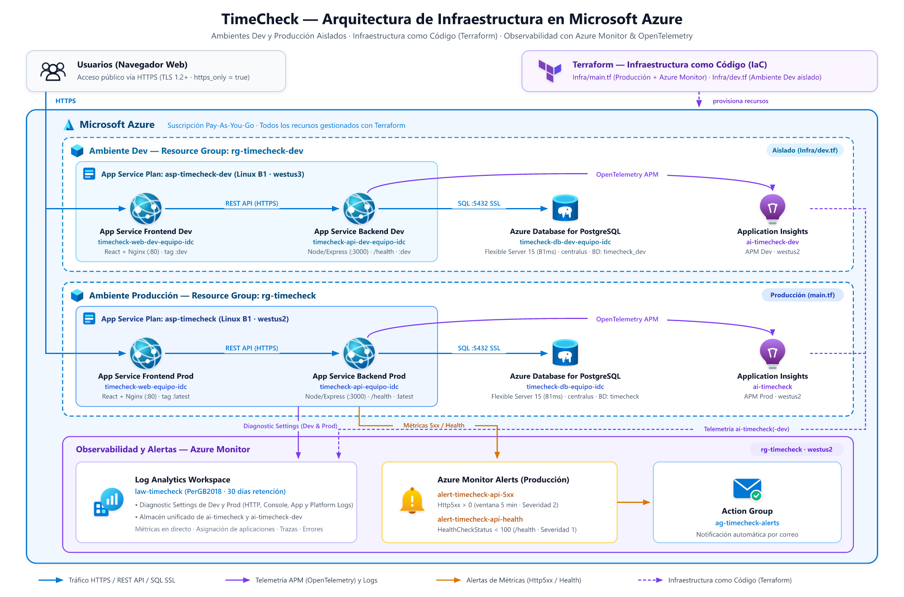
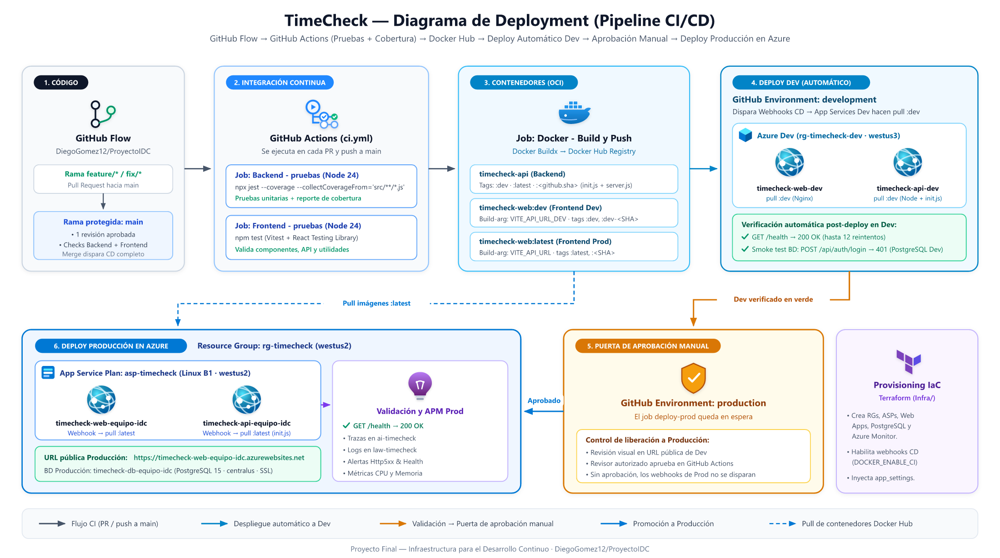

# ProyectoIDC – TimeCheck
Plataforma web para registrar entradas y salidas (Check-in / Check-out), construida para demostrar un ciclo completo de CI/CD con DevOps, contenedores, observabilidad e Infraestructura como Código en Microsoft Azure.

- **Propuesta formal y anexo final:** [Propuesta.md](Propuesta.md)
- **Wiki del proyecto:** [GitHub Wiki](https://github.com/DiegoGomez12/ProyectoIDC/wiki)
- **Plan de trabajo (Backlog):** [GitHub Project Board](https://github.com/users/DiegoGomez12/projects/1)

## Arquitectura y Deployment

### Infraestructura en Microsoft Azure (Dev, Producción y Observabilidad)



### Flujo de Deployment (CI/CD con GitHub Actions y Docker Hub)



## Documentación por sección
Cada sección tiene su propio README con el contexto de cómo y por qué se construyó.

| Sección | Documentación | Issues |
|---|---|---|
| Infraestructura en Azure (Terraform) | [Infra/README.md](Infra/README.md) | #11, #12, #29, #31 |
| Entorno local (Docker Compose) | [Docs/entorno-desarrollo-local.md](Docs/entorno-desarrollo-local.md) | #3 |
| Backend (API REST + pruebas) | [backend/README.md](backend/README.md) | #2, #4, #5, #6, #29 |
| Frontend (React + Vite + pruebas) | [frontend/README.md](frontend/README.md) | #2, #9, #10 |
| Integración y Despliegue Continuo (GitHub Actions) | [.github/workflows/README.md](.github/workflows/README.md) | #7, #8, #10, #12, #31 |

## Ambientes desplegados en Azure

| Ambiente | Frontend | Backend (`/health`) | Resource Group / APM |
|---|---|---|---|
| **Desarrollo (Dev)** | https://timecheck-web-dev-equipo-idc.azurewebsites.net | https://timecheck-api-dev-equipo-idc.azurewebsites.net/health | `rg-timecheck-dev` · `ai-timecheck-dev` |
| **Producción (Prod)** | https://timecheck-web-equipo-idc.azurewebsites.net | https://timecheck-api-equipo-idc.azurewebsites.net/health | `rg-timecheck` · `ai-timecheck` |

## Inicio rápido (desarrollo local)
No hace falta acceso a Azure: la base de datos corre en Docker.

1. Crear `.env` en la raíz con las variables de [la base de datos](Docs/entorno-desarrollo-local.md) y [el backend](backend/README.md#variables-de-entorno).
2. Levantar PostgreSQL y el Backend:
```bash
docker compose up -d          # PostgreSQL local
cd backend
npm install
npm run db:init               # crea las tablas e índices
npm run dev                   # API en http://localhost:3000/health
```
3. En otra terminal, levantar el Frontend:
```bash
cd frontend
npm install
npm run dev                   # SPA en http://localhost:5173
```


## Flujo de trabajo
GitHub Flow: ramas `feature/...` desde `main`, Pull Request con revisión de un compañero y merge a `main`.